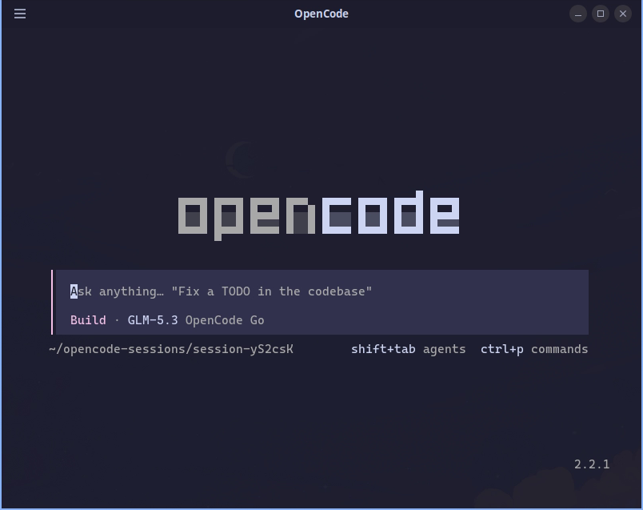
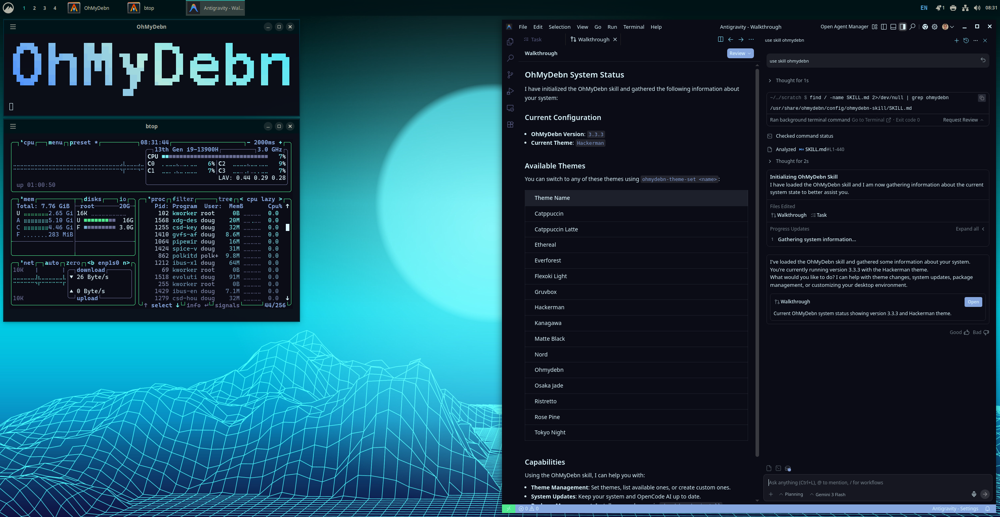

OhMyDebn includes several different options for your AI needs: OpenCode, OpenCode Desktop, Claude Code, Claude Desktop, ChatGPT, Codex, Grok Build, Crush, Pi, Oh My Pi, T3 Code, Visual Studio Code with GitHub Copilot AI, and Antigravity with Google Agentic AI.

## Default AI Assistant

Hotkey Super + A always launches your *default* AI assistant, so whichever one you use most is just a keypress away. Until you pick one yourself, the default is OpenCode.

When you install one of these AI tools from the OhMyDebn menu, you'll be asked whether to make it your default. The default answer is no, so your current default stays unless you type `y`.

To change your default AI assistant at any time, go to OhMyDebn Menu > Setup > Defaults > Agent. It lists the AI tools you have installed, marks your current default, and makes whichever one you pick the new default.

If you're in a terminal, the `a` alias runs your default assistant directly in that terminal (or opens it on the current directory for GUI options like ChatGPT, VS Code, and Antigravity; Claude Desktop, OpenCode Desktop and T3 Code just open).

## OpenCode

OpenCode is available as an optional installation. You can install via the OhMyDebn menu (Apps > AI). [OpenCode](https://opencode.ai/) runs in a terminal and automatically adapts to our [desktop themes](desktop-themes.md). From an existing terminal session, the `c` alias runs OpenCode directly.

OhMyDebn installs OpenCode 2. If you used OpenCode 1 before, your settings, sign-ins and conversations carry over: OpenCode converts its data to its new format the first time it starts, so it can't go back to version 1 afterwards. Plugins written for OpenCode 1 don't run in OpenCode 2 and need porting; see OpenCode's [guide to moving from version 1](https://opencode.ai/v2/docs/migrate-v1). OpenCode updates come with OhMyDebn's, so OpenCode's own `/update` command just tells you to update with your package manager.

## OpenCode Desktop

OpenCode Desktop is OpenCode's desktop app: the same OpenCode, in a window of its own instead of a terminal. It's available as an optional installation on x86_64 and arm64. You can install via the OhMyDebn menu (Apps > AI), where it's listed as "OpenCode App (desktop GUI)". You can then run via menu.

It uses the same settings, sign-ins and conversations as the [OpenCode](#opencode) terminal app. OhMyDebn keeps the two on the same version, and updates come with OhMyDebn's, so the app's own "Check for updates" always says you're up to date.

## Claude Code

[Claude Code](https://claude.com/claude-code) is available as an optional installation. You can install via the OhMyDebn menu (Apps > AI). You can run in an existing terminal session with the `claude` command. Alternatively, you can use hotkey Ctrl + Alt + C to start a terminal and run Claude. That hotkey checks to see if it's installed first, so even on a new installation you can just press Ctrl + Alt + C and it will install and then run. Claude Code automatically adapts to our [desktop themes](desktop-themes.md).

Claude Code installs on its stable release channel, which is about a week behind the newest release and skips releases with serious bugs. To get every release as soon as it ships, switch to the latest channel in OhMyDebn Menu > Update > Channel > Claude Code. See [Channels](updating.md#channels).

## Claude Desktop

[Claude Desktop](https://claude.com/download) is Anthropic's desktop app for Claude, with Claude Code built in, and is available as an optional installation. You can install via the OhMyDebn menu (Apps > AI), where it's listed as "Claude Desktop (Anthropic GUI)" to distinguish it from the Claude Code terminal app above. You can then run via menu. It follows your theme's light or dark mode.

You sign in with your Claude account. Chat works on any plan, while Claude Code and some other features need a paid plan (Pro, Max, Team or Enterprise). Anthropic's Linux version is still in beta: Computer Use and dictation aren't available on Linux yet.

Larger tasks, which Claude Desktop used to keep in a separate Cowork tab, now start from any chat. Claude can run them in a virtual machine on your computer, and OhMyDebn installs the software that virtual machine needs along with Claude Desktop. If those tasks won't start, check that your computer has what that virtual machine needs:

- Hardware virtualization turned on in your computer's firmware (BIOS or UEFI) settings. If OhMyDebn itself runs in a virtual machine, that virtual machine needs nested virtualization turned on.
- Your user in the `kvm` group. To join it, run `sudo usermod -aG kvm $USER`, then log out and back in.
- At least 8 GB of memory. The virtual machine uses 4 GB of it while it runs.
- About 25 GB of free disk space.

Claude Desktop updates come from Anthropic's own repository whenever you update OhMyDebn.

## ChatGPT

[ChatGPT](https://chatgpt.com/) is OpenAI's desktop app and is available as an optional installation. You can install via the OhMyDebn menu (Apps > AI), where it's listed as "ChatGPT (OpenAI GUI)" to distinguish it from Codex below. You can then run via menu.

## Codex

[Codex](https://github.com/openai/codex) is OpenAI's terminal-based coding agent and is available as an optional installation. You can install via the OhMyDebn menu (Apps > AI), where it's listed as "Codex (OpenAI CLI)". From an existing terminal session, the `codex` alias runs it directly.

## Grok Build

[Grok Build](https://x.ai/cli) is xAI's terminal-based coding agent and is available as an optional installation. You can install via the OhMyDebn menu (Apps > AI), where it's listed as "Grok Build (xAI CLI)". From an existing terminal session, the `grok` alias runs it directly. Grok Build automatically adapts to our [desktop themes](desktop-themes.md).

Grok Build needs either a SuperGrok or X Premium+ subscription, which you sign in with by running `grok login`, or an xAI API key from [console.x.ai](https://console.x.ai), which you set as the `XAI_API_KEY` environment variable.

## Crush

[Crush](https://github.com/charmbracelet/crush) is Charm's terminal-based coding agent and is available as an optional installation. Like OpenCode, it isn't tied to one AI company: it works with models from Anthropic, OpenAI, Google, OpenRouter and many other providers, including models you run yourself, and you can switch models in the middle of a session. You can install via the OhMyDebn menu (Apps > AI), where it's listed as "Crush (Charm, any model)". From an existing terminal session, the `crush` alias runs it directly.

To choose a model, press `Ctrl + L` in Crush, pick a provider, and paste your API key for it. Charm also offers its own subscription, Hyper, which you can choose there and sign in to.

Crush updates come from the OhMyDebn repository whenever you update OhMyDebn.

## Pi

[Pi](https://github.com/earendil-works/pi) is a terminal-based coding agent from earendil-works and is available as an optional installation. You can install via the OhMyDebn menu (Apps > AI). From an existing terminal session, the `pi` alias runs it directly.

## Oh My Pi

[Oh My Pi](https://github.com/can1357/oh-my-pi) is Stencil Labs' extended version of [Pi](#pi): a terminal-based coding agent with built-in code navigation and debugging, and support for many AI providers, including signing in with a subscription you already have. It's available as an optional installation. You can install via the OhMyDebn menu (Apps > AI), where it's listed as "Oh My Pi (Stencil Labs)". From an existing terminal session, the `omp` alias runs it directly. Oh My Pi automatically adapts to our [desktop themes](desktop-themes.md).

## T3 Code

[T3 Code](https://github.com/pingdotgg/t3code) is a desktop app that runs your AI coding agents side by side in one window. It isn't an AI assistant itself: it works with the agents you already have installed, such as OpenCode, Claude Code, Codex, Grok Build, and Pi, so install at least one of those first. T3 Code is available as an optional installation. You can install via the OhMyDebn menu (Apps > AI), where it's listed as "T3 Code (agent GUI)". You can then run via menu.

T3 Code automatically adapts to our [desktop themes](desktop-themes.md). If you pick a different theme in T3 Code's own Settings > Appearance, it keeps that choice instead. To follow your OhMyDebn theme again, select the OhMyDebn theme there.

If T3 Code shows one of your installed agents as turned off, turn it on in T3 Code's Settings > Providers.

## Visual Studio Code with GitHub Copilot AI

[Visual Studio Code](https://code.visualstudio.com/) with [GitHub Copilot](https://github.com/features/copilot) is available as an optional installation. You can install via the OhMyDebn menu (Apps > AI or Apps > Editors). You can run via menu or hotkey Ctrl + Super + S. That hotkey checks to see if it's installed first, so even on a new installation you can just press Ctrl + Super + S and it will install and then run.

## Antigravity with Google Agentic AI

[Antigravity](https://antigravity.google/) is a fork of Visual Studio Code for Google Agentic AI and is available as an optional installation. You can install via the OhMyDebn menu (Apps > AI or Apps > Editors). You can run via menu or hotkey Ctrl + Super + G. That hotkey checks to see if it's installed first, so even on a new installation you can just press Ctrl + Super + G and it will install and then run.

OhMyDebn installs Antigravity 1.x, the last version Google released as a Debian package. Google no longer updates it, and it may stop working at any time. The newer Antigravity 2 app and Antigravity IDE come as separate downloads from [Google's download page](https://antigravity.google/download?os=linux) and aren't managed by OhMyDebn.

## OhMyDebn skill

OhMyDebn includes an OhMyDebn skill that most of these AI tools, including Claude Code, OpenCode, OpenCode Desktop, Codex, Crush, Pi, and Antigravity, can use to understand more about the underlying platform:

<video src="../images/ohmydebn-opencode-skill.mp4" controls></video>
