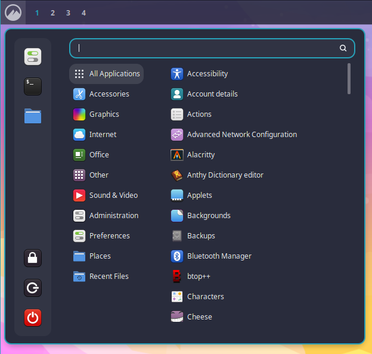
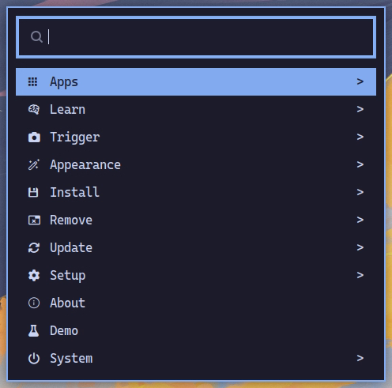
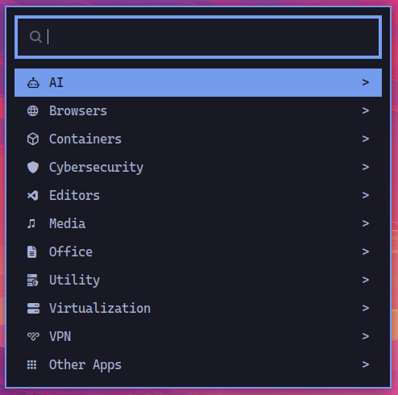

## Cinnamon Menu

The Cinnamon desktop includes its own menu that allows you to launch apps and configure Cinnamon. You can activate this menu by clicking the upper left corner or by pressing the `Super` key (usually the Windows key on most keyboards).

The Cinnamon menu includes an entry to launch the OhMyDebn menu.

## OhMyDebn Menu

The OhMyDebn menu allows you to launch apps, learn about OhMyDebn, and configure and control the system. You can activate this menu by clicking the grinning face on the panel, right next to the Cinnamon menu, by pressing `Super + Space`, or from the Cinnamon menu. If you remove that button from the panel, updates won't put it back.

Once open, you can browse categories with the arrow keys or start typing to instantly search across every option in the menu, not just the current category. Categories that lead to a further submenu are marked with a `>` on the right.

The first option launches the separate Apps menu. The rest of the top level:

- `Learn` - documentation links (see below)
- `Trigger` - screenshots, screen recording, a color picker, and the [network and disk speed tests](utilities.md#speed-test)
- `Appearance` - everything about how the desktop looks: the [theme carousel](desktop-themes.md) for your theme and background, [theme intros](desktop-themes.md#theme-intros) on or off, [tiling](window-tiling.md) settings, and Cinnamon's effects, fonts, notifications, panel, screensaver, windows, and workspaces settings
- `Install` and `Remove` - add or remove a package from your distro's repos (see [below](#installing-and-removing-packages)), a web app (a website wrapped as its own desktop app), or a terminal (TUI) app
- `Update` - [update OhMyDebn](updating.md), choose your update [channel](updating.md#channels), run the [doctor](updating.md#checking-your-installation), update your [firmware](updating.md#firmware), and change your password or timezone
- `Setup` - Bluetooth, defaults (your default [AI assistant](ai.md#default-ai-assistant) and [browser](browser.md#changing-the-default-browser)), display, gestures, [keybindings](hotkeys.md#customizing-keybindings), keyboard, mouse, network, power, printers, and sound
- `About` and `Demo` - the [system summary and animated logo](utilities.md)
- `System` - lock, suspend, relaunch Cinnamon, restart, or shut down

## Installing and removing packages

Install > Package and Remove > Package open a searchable list: every package your distro's repos offer, or every package that's installed. Type to search, press `Tab` to pick more than one, and `Enter` to go ahead. A preview below the list describes the highlighted package.

Removing shows everything apt will remove before it does anything (which can include other packages that depend on the ones you picked) and asks you to confirm. It removes the packages' system-wide settings too, not just the programs. Either way, the window tells you if the install or removal didn't finish.

## Apps Menu

To run applications, you can select `Apps` from the OhMyDebn menu. You can then use arrow keys to select which application you'd like to run or start typing the first few letters of the application name.

## Learn Menu

Select `Learn` from the OhMyDebn menu for quick links to documentation, opened in your [browser](browser.md):

- Keybindings (this site's [hotkeys](hotkeys.md) page)
- OhMyDebn (ohmydebn.org)
- Cinnamon
- Debian
- Neovim (LazyVim keymaps)
- Bash
