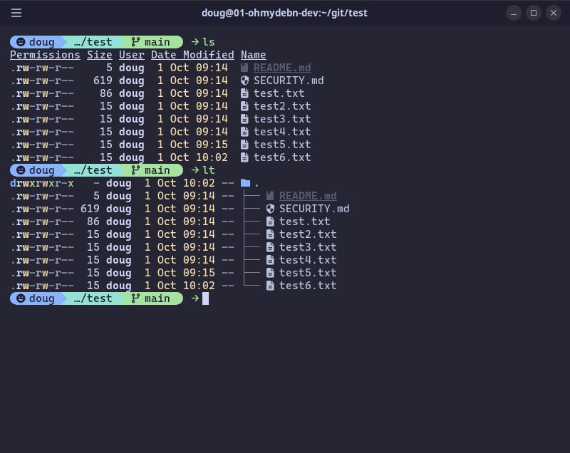
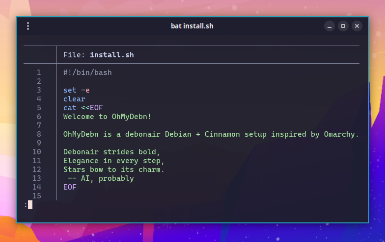

You can start a terminal session from the Cinnamon menu, Apps menu, or via [hotkey](hotkeys.md) `Super + Enter`. This launches a beautiful and powerful [Alacritty](https://alacritty.org) terminal window that includes:

- CaskaydiaMono Nerd Font
- [Zsh](https://en.wikipedia.org/wiki/Z_shell) shell with [Oh My Zsh](https://ohmyz.sh/), which comes with OhMyDebn and is updated with it (so `omz update` isn't needed). Your own Oh My Zsh plugins and themes go in `~/.oh-my-zsh/custom/plugins` and `~/.oh-my-zsh/custom/themes`.
- [Starship](https://starship.rs/) shell prompt, which starts with the OhMyDebn grin
- [Zoxide](https://github.com/ajeetdsouza/zoxide) for `z`, a smarter `cd` that jumps to directories you've used before
- [eza](https://github.com/eza-community/eza) for beautiful directory listings via `ls` and `lt`

It also includes [bat](https://github.com/sharkdp/bat), which is a `cat` clone with syntax highlighting and git integration.

A few more terminal-focused tools are available from the OhMyDebn menu's Apps > Terminals section.

## tmux

[tmux](https://github.com/tmux/tmux) is available as an optional installation. You can install it from the OhMyDebn menu (Apps > Terminals) or [hotkey](hotkeys.md) `Super + Alt + Return`. That hotkey checks to see if it's installed first, so even on a new installation you can just press `Super + Alt + Return` and it will install and then attach to a persistent session named `main` - closing and reopening the terminal returns you to where you left off.

## PowerShell

[Microsoft PowerShell](https://github.com/PowerShell/PowerShell) is available as an optional installation. You can install it from the OhMyDebn menu (Apps > Terminals) or [hotkey](hotkeys.md) `Ctrl + Alt + P`.

## herdr

[herdr](https://github.com/herdrdev/herdr) is a terminal workspace for AI coding agents (Claude Code, Codex, OpenCode, and others). It runs their terminals in a background server, so an agent keeps working when you close the terminal or lose your SSH connection, and you can reattach to check on it. To keep agents working while your own computer is off or asleep, run herdr on a server and connect to it. It's available as an optional installation. You can install it from the OhMyDebn menu (Apps > Terminals) or [hotkey](hotkeys.md) `Ctrl + Super + Return`. That hotkey checks to see if it's installed first, so even on a new installation you can just press `Ctrl + Super + Return` and it will install and then run.

herdr updates come from the OhMyDebn repository whenever you update OhMyDebn, so OhMyDebn turns off herdr's own check for new versions by setting `version_check = false` under `[update]` in `~/.config/herdr/config.toml`. It does this once and leaves a `version_check` you set yourself alone.
